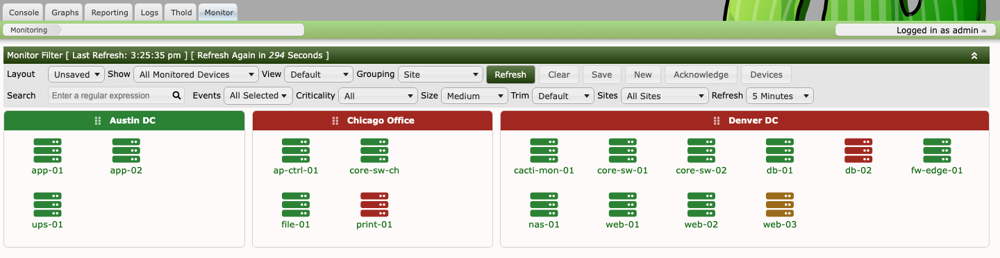

# monitor

This plugin allows you to view at a glance all your critical Cacti hosts, and
will alert you audibly and via Email when a Device or Devices go down.

Some audio clips have been added to this plugin courtesy of SoundBible.com and
are licensed under Creative Commons and other Free to use Licenses.  If you
choose the 'First Orders Suite.mp3' clip in the `sounds` directory, you may get
a surprise.

## Versions and compatibility

This README describes the `develop` source branch.

| Code | Plugin version | Minimum Cacti declared in `INFO` |
| --- | --- | --- |
| [Source branch](https://github.com/Cacti/plugin_monitor/blob/develop/INFO) | 3.0 | 1.2.29 |
| [Published v2.9](https://github.com/Cacti/plugin_monitor/releases/tag/v2.9) | 2.9 | 1.2.15 |

Use the published release’s assets and tagged documentation when installing that
package. Branch code can include later changes, even when its version number
matches the release. Cacti’s own PHP and database requirements also apply.

Install this plugin in **`<cacti-root>/plugins/monitor`**, using the directory
name `monitor` rather than `plugin_monitor`.

See [CHANGELOG.md](https://github.com/Cacti/plugin_monitor/blob/develop/CHANGELOG.md) for the version history.

## Screenshot

The Monitor board with devices grouped by site. A card takes the color of its
worst device: here db-02 and print-01 are down and web-03 is recovering. The
screenshot was taken on Cacti 1.2.32 with demo devices.

## Features

* Data Center Dashboard

* Audible and Visual Alerting

* Respects Cacti's user permissions

* Monitoring can be enabled or disabled at the Device level

* Supports Monitoring Devices by Criticality

## Requirements

Install and enable **Thold 1.2.1 or later**, the dependency declared in `INFO`,
before enabling Monitor. Use Cacti’s mail settings to verify notification delivery.

## Installation

To install the Monitor plugin, simply copy the plugin_monitor directory to
Cacti's plugins directory and rename it to simply 'monitor'. Once you have done
this, goto Cacti's Plugin Management page, Install and Enable Monitor. Once
this is complete, you can grant users the 'View Monitoring Dashboard' realm
permission to view the Monitor tab.

It would be advisable to view Monitors email notification settings under
Settings in Cacti.  Monitor is configured from the Monitor tab in Settings, and
Devices can have their Criticality in the Cacti Device Management page.  Monitor
includes a Device filter to show Devices of differing criticalities.

## Bugs and Feature Enhancements

Bug and feature enhancements for the monitor plugin are handled in GitHub. If
you find a first search the Cacti forums for a solution before creating an issue
in GitHub.

## Architecture

The proposed architectural direction for Monitor is documented in the
[Architecture Decision Record](docs/architecture/0001-hexagonal-monitor.md).

-----------------------------------------------
Copyright (c) 2004-2026 - The Cacti Group, Inc.
